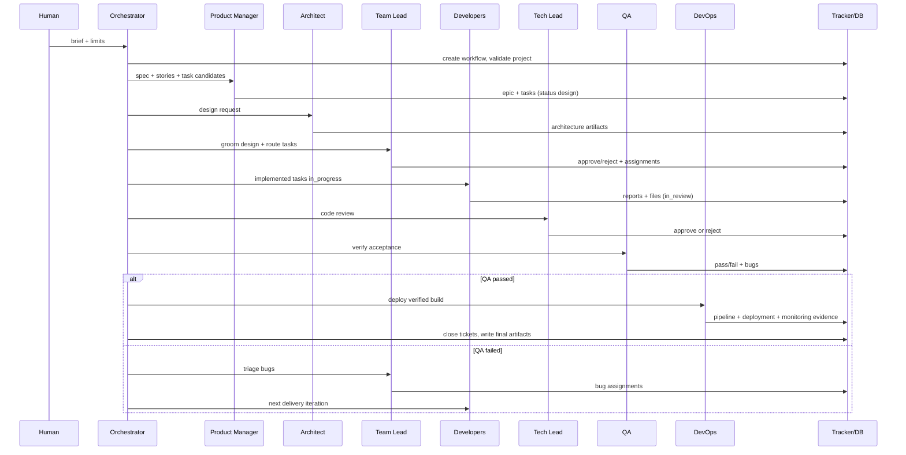

# Agentic Workflow

> Execution counterpart to [`ARCHITECTURE.md`](ARCHITECTURE.md). This document
> defines how a brief becomes deployed code: the stages, trigger conditions,
> handoff contracts, loops, and failure paths.

## 0. Invocation

A workflow starts from the web UI (**Build lab**) or the CLI:

```bash
npm run cli -- build "BRIEF" --title "T" --repo PATH --max-iterations 5
```

`BuildService.run()` creates a `workflow_run` and calls `execute()`. The
orchestrator owns the run; every subsequent agent is started automatically by a
status transition. No role needs a manual kickoff.



## 1. Stage contracts

### Phase 0 — Intake and target validation

**Owner:** orchestrator (deterministic).

1. Create the workflow record and workspace.
2. If an existing repository was supplied, validate it: dependency install,
   typecheck, build, and tests where available.
3. Attach the validation summary to the PM task. Validation failures do not stop
   the workflow; they become context the PM must account for.

**Artifacts:** workflow record, validation report (when applicable).
**Gate:** workspace exists and is a git repository.

### Phase 1 — Product discovery and specification

**Agent:** `product_manager`.
**Trigger:** workflow created.
**Inputs:** brief, validation report, existing product context.

The PM must:

1. Restate the problem, the primary user, and the smallest valuable v1.
2. Extract explicit requirements and identify gaps, conflicts, and undefined
   success criteria.
3. Ask only questions that change scope, design, or acceptance; otherwise record
   a reversible assumption and an open question.
4. Define the epic, user stories, testable acceptance criteria, non-goals, risks,
   and a delivery sequence.
5. Produce a candidate task breakdown (`area`: backend, frontend, fullstack,
   docs, infra).

**Artifacts:** `product_spec.md`, `product_spec.json`.
**Tickets:** epic + task candidates in `design`, assigned to the architect.
**Gate:** the spec exists and every task has a description and acceptance
criteria (or an explicit deferral).

> The PM's task list is a *candidate* breakdown. The team lead owns the final
> grooming and routing decision and may reject unclear work back to the PM or
> architect.

### Phase 2 — Architecture and design

**Agent:** `architect`.
**Trigger:** product spec committed; tasks in `design`.
**Inputs:** PRD, acceptance criteria, task candidates, prior team-lead feedback.

The architect must produce:

- the smallest reasonable stack and rejected alternatives;
- a concrete file plan with one owner (task + developer role) per file/interface;
- data model, persistence, routes/commands, and error/security/privacy notes;
- a test plan QA can execute;
- open questions the team lead must resolve;
- top risks.

The design is attached to every task as a ticket comment and artifact
(`architecture.md`, `architecture_roundN.md`, `architecture.json`).

**Loop:** if the team lead rejects, the architect receives the concrete issues and
tries again, up to **2 rounds**. If the second round still fails, the workflow
proceeds with the best available design and records the unresolved issues; a
human should review the design artifacts.

**Gate:** architecture artifact exists and covers every task.

### Phase 3 — Grooming and design review

**Agent:** `team_lead`.
**Trigger:** design attached; tasks in `team_review`.
**Inputs:** PRD, architecture, candidate tasks.

The team lead:

1. Checks the epic and every story/task is understood, has testable acceptance
   criteria, one owner, and a design element.
2. Rejects with **targeted questions for the architect** when the design is not
   implementable as written. No guessing.
3. Approves only when the design is TypeScript, strict, and implementable.
4. Assigns every task to exactly one developer role:
   - backend: APIs, data, CLI, persistence, server;
   - frontend: templates, components, styles, client behavior.
5. Reports cross-cutting risks and missing integration points.
6. On QA failure, runs bug triage (`team_lead_triage`) and assigns each bug.

**Artifacts:** `team_lead_design_review_roundN.md`; bug triage markdown.
**Tickets:** approved tasks move to `in_progress` with the developer assignee.
**Gate:** every task has an owner and a testable criterion.

### Phase 4 — Implementation

**Agents:** `backend_developer`, `frontend_developer` (two instances per role).
**Trigger:** approved design; tasks `in_progress`.
**Inputs:** PRD, architecture, file plan, test plan, assigned tickets, prior
feedback, runtime constraints.

Each developer must:

1. Write real files with the provided tools; no descriptions in place of code.
2. Follow the architecture's ownership boundaries.
3. Add tests that match the acceptance criteria and QA plan.
4. Run `npm install` (when needed), `npm run typecheck`, and `npm test`; fix
   failures before finishing.
5. Include blocking feedback from the tech lead or QA in the resubmission.
6. Return the structured developer report: summary, files written, tests run,
   known issues, tasks completed.

**Artifacts:** source files, tests, `<role>_report_iterN.md/json`.
**Tickets:** move to `in_review`, assigned to the tech lead.
**Gate:** files exist, the report is complete, and the mandatory gates have been
attempted with evidence.

### Phase 5 — Code review

**Agent:** `tech_lead`.
**Trigger:** developer reports submitted; tickets `in_review`.
**Inputs:** PRD, design, tickets, reports, workspace, gate results.

The tech lead must:

1. Check every acceptance criterion against the implementation.
2. Confirm TypeScript-only source, strict `tsconfig.json`, and no `.js` source.
3. Check design fidelity; every deviation must be justified and documented.
4. Re-run or independently confirm typecheck/tests/build. Developer claims are
   not evidence.
5. Reject with concrete blocking issues; the **same developer** fixes and
   resubmits.
6. Approve only when the implementation is ready for independent verification.

The orchestrator also runs a deterministic dependency-install check before the
review; an install failure becomes a blocking review finding.

**Artifacts:** `tech_lead_report_iterN.md`, `tech_lead_report.md/json`.
**Tickets:** approve -> `qa`; reject -> `in_progress` with feedback.
**Gate:** verdict true + no blocking issues + gates independently confirmed.

### Phase 6 — Acceptance verification

**Agent:** `qa`.
**Trigger:** tech lead approved; tickets `qa`.
**Inputs:** PRD, design, tickets, files, prior feedback.

QA must:

1. Inspect the workspace and confirm TypeScript source.
2. Run typecheck and tests.
3. Verify the epic, every story, and every acceptance criterion individually.
4. Classify failures by severity and open one structured bug per concrete
   failure (title, description, severity, area, parent task).
5. Provide evidence: commands, output excerpts, and criteria checked.
6. Return a clear pass/fail verdict and recommendation.

**Artifacts:** `qa_report_iterN.md`, `qa_report.md/json`.
**Tickets:** pass -> DevOps; fail -> linked bugs created in `team_review` and
assigned to the team lead.
**Gate:** every criterion has evidence; any failure produces at least one bug.

### Phase 7 — Deployment and operations

**Agent:** `devops`.
**Trigger:** QA passed.
**Inputs:** verified build, spec, tickets, QA report, pipeline files.

DevOps must:

1. Check the build instructions are complete (install, build, typecheck, test,
   start, health check, environment variables). Report gaps instead of guessing.
2. Keep CI/CD/GitOps files consistent with the repository.
3. Run the final deterministic gate: typecheck, build, tests.
4. Start the app and verify it responds; validation and monitoring begin at
   startup.
5. Own health checks, startup logs, structured logging, and monitoring.
6. On failure, report the exact error and stop; open a structured issue rather
   than retrying blindly.
7. Never modify product source, tests, or architecture.

**Artifacts:** `devops_report_iterN.md`, `devops_report.md/json`.
**Tickets:** all open tickets close with QA + deployment evidence; epic closes.
**Gate:** final gates pass, health check succeeds, monitoring is active.

### Phase 8 — Close

The orchestrator:

1. Closes every task and bug with the combined QA + DevOps evidence.
2. Closes the epic.
3. Writes ticket snapshots and final commits.
4. Marks the workflow `done` and records the result.

If the iteration budget is exhausted before QA passes, the epic is marked
`blocked`, open tickets remain on the board, and `blocked_report.md` is written.

## 2. Ticket lifecycle

```text
todo
  -> design          PM creates task; architect designs
  -> team_review     design attached; team lead grooms/routes
  -> in_progress     developer implements (or bug fix)
  -> in_review       developer report submitted; tech lead reviews
  -> qa              tech lead approved; QA verifies
  -> done            QA passed; DevOps deployed and verified

Any state -> blocked when the loop limit is reached or an unrecoverable failure
occurs. A human can rescope and re-run.
```

| Status | Owner | Allowed next states |
|---|---|---|
| `todo` | PM / tracker | `design`, `blocked` |
| `design` | Architect | `team_review`, `blocked` |
| `team_review` | Team lead | `in_progress`, `design`, `blocked` |
| `in_progress` | Developer | `in_review`, `blocked` |
| `in_review` | Tech lead | `qa`, `in_progress`, `blocked` |
| `qa` | QA | `done`, `in_progress` (via bugs), `blocked` |
| `done` | — | terminal |
| `blocked` | Human / PM | `design` after rescope |

Every transition writes a `ticket_events` row with actor, reason, and evidence.

## 3. Feedback loops and bounds

| Loop | Trigger | Bound | Exhaustion behaviour |
|---|---|---|---|
| Design review | Team lead rejects architecture | 2 rounds | Proceed with unresolved issues recorded; human reviews |
| Delivery | Tech lead rejects implementation | Within iteration budget | Developer receives feedback and resubmits |
| QA/bug | QA fails | `DEV_FIRM_MAX_ITERATIONS` (default 5) | Epic `blocked`; open bugs remain on board |
| Agent tools | Model repeats failing tool calls | `DEV_FIRM_MAX_STEPS` (default 40) | Agent returns failure report; stage records error |
| Command retry | Same command fails | 2 attempts | Stop, log the error, return a blocked handoff |
| Fixer | Defect logged | Session-scoped | Fix or report follow-up; never loops forever |

The iteration limit applies to the *delivery loop as a whole*, not per role. A
QA failure opens linked bugs, the team lead triages them, and the next iteration
starts with those bugs as the active work items.

## 4. Trigger and automation rules

1. **Status is the event.** An agent starts because a ticket reached a status it
   owns, not because a human clicked its name.
2. **One owner at a time.** The orchestrator transitions the ticket before
   invoking the next role.
3. **Gate before transition.** A role may not move a ticket forward until its gate
   evidence exists.
4. **Deterministic checks are not delegated.** Dependency install, final
   typecheck/build/test, and target validation are run by the orchestrator even
   when an agent also runs them.
5. **No infinite autonomy.** Every loop has a bound and a visible blocked state.
6. **Human escalation.** Unresolved product ambiguity, repeated design rejection,
   and exhausted iteration budgets are surfaced, not papered over.
7. **Separate defect loop.** Firm-level errors go to `Bugs/_inbox/` for the
   fixer; product defects stay in tickets for the delivery loop.

## 5. Shared skills in the workflow

Skills are attached to roles, not stages, and are resolved when the agent is
constructed. Shared skills enforce standards across handoffs:

| Stage | Relevant skills |
|---|---|
| PM discovery | `clarifying-questions`, `acceptance-criteria`, `ticket-handoff` |
| Architecture | `design-review`, `clarifying-questions`, `typescript-runtime` |
| Team-lead grooming | `clarifying-questions`, `acceptance-criteria`, `design-review` |
| Implementation | `quality-gates`, `typescript-runtime`, `ticket-handoff` |
| Tech-lead review | `design-review`, `quality-gates`, `acceptance-criteria` |
| QA | `acceptance-criteria`, `quality-gates`, `ticket-handoff` |
| DevOps | `quality-gates`, `ticket-handoff`, `error-reporting` |
| Any failure | `error-reporting` -> fixer |
| Any new domain fact | `knowledge-capture` -> `Context/_inbox/` |

Add a skill without touching code:

```md
---
id: api-contracts
name: API Contracts
description: Keep backend and frontend contracts aligned.
agents: architect, backend_developer, frontend_developer, tech_lead
---

- ...
```

To opt one agent into an existing skill, add `skills: api-contracts` to that
agent's frontmatter. Resolution order and overrides are documented in
[`skills/README.md`](skills/README.md).

## 6. Failure playbook

| Symptom | First response | Destination |
|---|---|---|
| Target project fails validation | PM accounts for it in scope; do not hide it | Spec risks/assumptions |
| Model returns invalid JSON | Runtime repairs/retries; otherwise stage fallback | Error artifact; fixer if recurring |
| Dependency install fails | Tech lead blocks with versions/error | Developer fixes manifest |
| Typecheck/test fails | Developer fixes; tech lead and QA re-run | Delivery loop |
| Design not implementable | Team lead rejects with targeted questions | Architect (max 2 rounds) |
| QA finds a criterion failure | Structured bug with evidence | Team-lead triage -> developer |
| QA cannot run | QA opens a blocker bug with the environment error | Team-lead triage |
| Deployment fails | DevOps stops and reports exact error | Structured issue; human/fixer |
| Firm/pipeline defect | Log tagged evidence in `Bugs/_inbox/`; the orchestrator also appends stage/fatal failures deterministically | Fixer (`/fix-bugs`) |
| Iteration budget exhausted | Epic `blocked`, open tickets preserved | Human rescope |
| Unresolved product ambiguity | PM records open question; escalate if critical | Human |

## 7. Artifact and evidence map

| Phase | Primary artifacts | Ticket evidence |
|---|---|---|
| Intake | workflow record, validation report | — |
| Product | `product_spec.md/json` | epic description + task criteria |
| Architecture | `architecture.md`, `architecture_roundN.md/json` | design comment per task |
| Grooming | `team_lead_design_review_roundN.md` | assignments + review verdict |
| Implementation | source files, tests, `<role>_report_iterN.md/json` | files + tests run |
| Code review | `tech_lead_report_iterN.md`, `tech_lead_report.md/json` | verdict + blocking issues |
| QA | `qa_report_iterN.md`, `qa_report.md/json` | per-criterion evidence + bugs |
| DevOps | `devops_report_iterN.md`, `devops_report.md/json` | pipeline + deployment + health |
| Close | `tickets.md/json`, final commits | closing evidence |
| Blocked | `blocked_report.md` | blocking reason + open tickets |

## 8. Adding or changing a stage

1. Define the trigger state, owner, inputs, output schema, gate evidence, and
   rejection path.
2. Add the status/transition to the tracker if it is new.
3. Wire the stage into `BuildService` and the status reporter.
4. Add the agent definition and skill targets if the stage uses a new role.
5. Update this document, `ARCHITECTURE.md`, and `agents/README.md`.
6. Add a test that proves the gate rejects without evidence and advances with it.
7. Run `npm run typecheck && npm test`.
