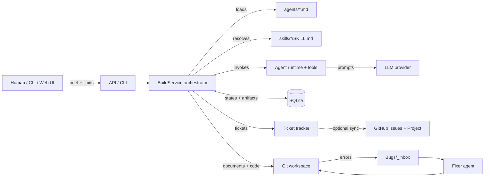

# Dev Firm — Architecture

> Source of truth for the firm's agents, autonomy model, handoff contracts, and
> shared skills. The stage-by-stage execution detail lives in
> [`AGENTIC_WORKFLOW.md`](AGENTIC_WORKFLOW.md); agent file formats live in
> [`agents/README.md`](agents/README.md) and [`skills/README.md`](skills/README.md).

## 1. What the firm is

Dev Firm is a local-first, agent-run software delivery organization. A human
gives a brief; the firm validates the target repository, produces a product spec
and design, implements and reviews the code, verifies acceptance, deploys the
verified build, and keeps a complete audit trail.

The firm is not a chat wrapper around one model. It is a **bounded delivery
pipeline** with explicit roles, artifacts, ticket states, and gates. Each agent
is a stateless worker invoked by the orchestrator when its trigger condition is
met; the orchestrator and the ticket board hold all state.

### Design principles

1. **Local-first.** The runtime, database, workspace, and artifacts live on the
   user's machine. A cloud model provider is optional.
2. **Agents are workers, not the scheduler.** Agents do not start themselves.
   The orchestrator starts them on a ticket transition or an explicit event.
   This keeps runs resumable, auditable, and bounded.
3. **Every handoff is evidence-backed.** A role may only move a ticket forward
   when its gate is satisfied; otherwise the ticket moves back with a concrete
   reason.
4. **Autonomy is bounded.** Design loops, delivery iterations, agent steps, and
   retries have hard limits. Exhaustion produces a blocked ticket and a report,
   never an infinite loop.
5. **Definitions are Markdown; behavior is code.** Prompts, task templates, and
   sampling settings live in `agents/*.md`; shared instructions live in
   `skills/*/SKILL.md`. Changing either affects the next run without a rebuild.
6. **One source of truth per fact.** Tickets own status; artifacts own documents;
   SQLite owns the audit trail; `Context/` owns durable domain knowledge; the
   bug inbox owns defects for the fixer.
7. **Human on the loop.** The human sets the brief and the limits, and is the
   escalation point for unresolved product ambiguity or repeated failure.

## 2. System context



### Layers

| Layer | Responsibility | Main code |
|---|---|---|
| Presentation | Setup, settings, build lab, ticket board, CLI | `src/api/`, `views/`, `src/cli.ts` |
| Orchestration | Stage sequencing, gates, loops, status reporting, commits | `src/orchestrator/` |
| Agent definitions | Role identity, prompt, task template, sampling, skill opt-ins | `agents/*.md` |
| Shared skills | Cross-role standards injected into system prompts | `skills/*/SKILL.md` |
| Agent runtime | Tool-calling loop, JSON repair, schema validation, audit | `src/agents/base.ts`, `runner.ts`, `schema.ts` |
| Tools | Sandboxed file/command access, dependency install | `src/agents/tools.ts` |
| Intelligence | Provider-neutral LLM clients (OpenAI, Anthropic, Ollama, OpenCode, mock) | `src/llm/` |
| State | SQLite workflows, runs, artifacts, tickets, events, settings | `src/db.ts` |
| Tracking | Local ticket board and GitHub mirror | `src/tracker/` |
| Knowledge | Durable domain memory, router, inbox | `Context/` |
| Defect loop | Bug inbox and fixer | `Bugs/`, `.opencode/agents/fixer.md` |

## 3. Agent roster

Each agent is defined by a Markdown file and invoked by the orchestrator when its
trigger is reached. "Next" is the default happy-path handoff.

| Agent id | Team / role | Trigger | Inputs | Gate / output | Next |
|---|---|---|---|---|---|
| `product_manager` | Product | Build starts, or a blocked epic needs rescoping | Brief, project validation report | PRD with epic, stories, testable acceptance criteria, non-goals, assumptions, task candidates | Architect |
| `architect` | Design | Product spec committed | PRD, acceptance criteria, task candidates, team-lead feedback | Stack, alternatives, file plan, data model, interfaces, ownership, test plan, open questions | Team lead |
| `team_lead` | Delivery | Design attached, or QA opened bugs | PRD, architecture, candidate tasks | Grooming verdict; targeted questions for architect; per-task developer assignment; bug triage | Developers |
| `backend_developer` | Implementation | Task assigned `in_progress` and owned by backend | Spec, architecture, file plan, test plan, assigned tickets, feedback | Real files, tests, implementation report | Tech lead |
| `frontend_developer` | Implementation | Task assigned `in_progress` and owned by frontend | Same as backend, UI boundaries | Real files, tests, implementation report | Tech lead |
| `tech_lead` | Review | Developer reports submitted `in_review` | PRD, design, tickets, developer reports, diff, gate results | Pass/fail verdict, blocking issues, design-fidelity findings | QA or back to developer |
| `qa` | Verification | Tech lead approved `qa` | PRD, design, tickets, files, test evidence | Per-criterion pass/fail, bugs, evidence, recommendation | DevOps or team-lead triage |
| `devops` | Operations | QA passed | Verified build, spec, tickets, QA report, pipeline files | Build-instruction check, final gates, deploy, health/monitoring/logging status | Close tickets |
| `fixer` | Maintenance | `/fix-bugs` or a scheduled intake of `Bugs/_inbox/` | Logged defects with evidence | Root cause, fix or developer handoff, tests run, follow-ups | Human / normal delivery loop |

`team_lead_triage` is a second team-lead definition (`agents/team-lead-triage.md`)
used only for QA bug triage. It shares the `team_lead` role identity so the audit
trail attributes bug triage to the same owner.

### Role boundaries

- The **PM** owns *what* and *why*; it does not design or estimate implementation.
- The **architect** owns *how* at the system level; it does not write product code.
- The **team lead** owns *delivery shape*: grooming, task routing, bug triage, and
  escalation to the architect. It does not review code for correctness.
- **Developers** own implementation inside the assigned scope. They do not change
  the design silently or touch another role's files without an integration reason.
- The **tech lead** owns code review and design fidelity. It does not fix code
  itself; it rejects with actionable findings.
- **QA** owns acceptance verification and bug evidence. It does not judge style or
  rewrite the code.
- **DevOps** owns build instructions, CI/CD, deployment, and operational
  observability. It does not change product source, tests, or architecture.
- The **fixer** owns defect triage for the firm itself. It may spawn a developer
  for a substantial fix but never edits `Context/**/Memory.md` or runs git.

## 4. Autonomy model

### 4.1 The orchestrator is the scheduler

`BuildService` creates a `workflow_run`, materializes the epic and tickets, and
then advances the workflow through phases. Each phase calls exactly one role (or
one developer group), persists the artifact and ticket transition, and evaluates
the gate before choosing the next phase.

This is an event-driven design without a message broker: the **ticket status and
the last artifact are the events**. A role becomes active because its trigger
state exists, not because a human started it. That makes the same workflow
runnable from the CLI, the web UI, or a future scheduler.

### 4.2 Trigger table

| Event / state | Auto-started agent | Why |
|---|---|---|
| Workflow created | `product_manager` | Intake always starts with product discovery |
| `product_spec.md` committed, tasks in `design` | `architect` | Design is needed before review |
| Design attached, tickets in `team_review` | `team_lead` | Design must be groomed and routed |
| Design approved, tickets `in_progress` | `backend_developer` / `frontend_developer` | Implementation starts per assignment |
| Developer reports submitted, tickets `in_review` | `tech_lead` | Code review is the next gate |
| Tech lead approved, tickets `qa` | `qa` | Independent acceptance verification |
| QA passed | `devops` | Only verified builds deploy |
| QA failed | `team_lead` (triage) → developer | Bugs re-enter the delivery loop |
| Delivery limit reached | none; epic `blocked` | Bounded autonomy, human escalation |
| Defect in `Bugs/_inbox/` | `fixer` | Firm-level errors are investigated separately |

### 4.3 Ticket state machine

```mermaid
stateDiagram-v2
    [*] --> design: PM creates task
    design --> team_review: architect attaches design
    team_review --> in_progress: team lead approves + assigns
    team_review --> design: reject design (max 2 rounds)
    in_progress --> in_review: developer hands off
    in_review --> in_progress: tech lead rejects
    in_review --> qa: tech lead approves
    qa --> in_progress: QA opens bugs -> team lead triage
    qa --> done: QA passes; DevOps deploys and verifies
    design --> blocked: limit or unrecoverable failure
    team_review --> blocked: limit or unrecoverable failure
    in_progress --> blocked: limit or unrecoverable failure
    in_review --> blocked: limit or unrecoverable failure
    qa --> blocked: limit or unrecoverable failure
    blocked --> design: human rescope / re-run
```



Actual status values are `todo`, `design`, `team_review`, `in_progress`,
`in_review`, `qa`, `done`, and `blocked`. Every transition is written to
`ticket_events` with the actor and reason, and mirrored to GitHub when sync is
enabled.

### 4.4 Scheduler guarantees

- **Single writer per ticket.** A ticket has exactly one assignee at a time; the
  orchestrator performs the transition before invoking the next role.
- **Idempotent artifacts.** Artifacts are named by stage and iteration
  (`architecture_round1.md`, `tech_lead_report_iter2.md`) so a resumed run can
  tell what already happened.
- **Bounded loops.** Architecture review: 2 rounds. Delivery: `DEV_FIRM_MAX_ITERATIONS`
  (default 5). Agent tool steps: `DEV_FIRM_MAX_STEPS` (default 40). Repeated
  identical command failures stop after two attempts.
- **Fail visible, not silent.** A stage that cannot run records a structured
  error artifact and degrades to a conservative verdict (for example, QA failure
  rather than a false pass). Unrecoverable workflow errors mark the workflow
  `failed` and preserve the error.
- **Human escalation.** A blocked epic leaves open tickets on the board and writes
  `blocked_report.md`; unresolved product ambiguity belongs to the human, not to
  an agent inventing scope.

## 5. Handoff contracts

Every role returns a structured payload validated by a Zod schema
(`src/agents/schema.ts` -> `src/models.ts`). The orchestrator persists both the
structured payload and a Markdown artifact.

### 5.1 Common envelope

Every handoff must contain:

| Field | Meaning |
|---|---|
| Ticket key(s) | Exact tickets affected by this handoff |
| Summary | What changed and why, in one paragraph |
| Artifacts | Paths produced or consumed |
| Acceptance evidence | Criteria checked, commands run, outputs observed |
| Known issues | Non-blocking observations and follow-ups |
| Verdict / next owner | Pass/fail or approve/reject, and the next role |

### 5.2 Gate table

| Transition | Required evidence | Rejection path |
|---|---|---|
| Intake → design | Target project validated; brief understood; epic/stories/criteria exist | PM records assumptions/open questions |
| Design → team review | File plan, interfaces, data model, ownership, test plan, open questions | Team lead rejects to architect with targeted questions |
| Team review → implementation | Every task has one owner, testable criteria, and a design element | Reject or escalate ambiguity |
| Implementation → code review | Files written, typecheck/test output, report with known issues | Tech lead rejects to same developer |
| Code review → QA | Criteria map, design fidelity, independently confirmed gates | Reject to developer |
| QA → DevOps | Per-criterion pass, evidence, bugs for every failure | Bugs to team-lead triage |
| DevOps → done | Build instructions complete, final gates pass, health check and monitoring active | Stop and open structured issue |

A role must never claim a gate passed without the command, test name, or observed
output in the handoff.

## 6. Shared skills subsystem

Skills are reusable instruction modules that several agents share. They keep role
prompts short and make cross-team standards consistent.

### 6.1 Layout and format

```text
skills/
  acceptance-criteria/SKILL.md
  ticket-handoff/SKILL.md
  quality-gates/SKILL.md
  typescript-runtime/SKILL.md
  clarifying-questions/SKILL.md
  design-review/SKILL.md
  error-reporting/SKILL.md
```

```md
---
id: quality-gates
name: Quality Gates
description: Mandatory verification before implementation handoff.
agents: backend_developer, frontend_developer, tech_lead, qa, devops
---

Instructions...
```

### 6.2 Selection and resolution

A skill applies to an agent when either:

1. its `agents` field is `*` or contains the agent id; or
2. the agent's `skills:` frontmatter lists the skill id.

Resolution order, lowest priority first: bundled `skills/` -> `<home>/skills` ->
`DEV_FIRM_SKILLS_DIR`. Later directories override by skill id, matching the agent
override model. The loader (`src/agents/skills.ts`) is called when the agent is
constructed; the rendered skill block is appended to the system prompt by
`systemPromptFor(...)`.

### 6.3 Ownership

- The **architect** and **team lead** propose new cross-role standards.
- Any role may propose a skill, but skills are reviewed like code because they
  affect every targeted agent.
- Skills must not contain secrets, volatile facts, or project-specific values.
  Project facts belong in `Context/`; config values belong in configuration.
- A skill that is useful to only one agent should stay in that agent's prompt.

### 6.4 Current skill matrix

| Skill | Applies to | Enforces |
|---|---|---|
| `acceptance-criteria` | all | Concrete, testable criteria and traceability |
| `ticket-handoff` | all | Complete evidence-backed status transitions |
| `quality-gates` | developers, tech lead, QA, DevOps | Install, typecheck, test, build evidence |
| `typescript-runtime` | architect, developers, tech lead, QA, DevOps | TypeScript-only, strict config, `node:sqlite`, current versions |
| `clarifying-questions` | PM, architect, team lead | Validate requirements; ask only blocking questions |
| `design-review` | architect, team lead, tech lead | Reviewable design and design-fidelity review |
| `error-reporting` | all | Capture and log defects for the fixer |
| `knowledge-capture` | all | Stage durable new domain facts for the librarian |

## 7. Error handling and the fixer loop

There are three distinct failure classes; they must not be conflated:

| Failure class | Owner | Destination |
|---|---|---|
| Product/acceptance defect | QA | Linked bug ticket -> team-lead triage -> developer |
| Build/deploy failure | DevOps | Structured issue + blocked deploy; no blind retries |
| Firm/pipeline defect (tool, provider, harness, environment) | Fixer | `Bugs/_inbox/YYYY-MM-DD_<slug>.md` |

The bug inbox format is defined in [`Bugs/_inbox/README.md`](Bugs/_inbox/README.md).
Every entry carries evidence and a scope tag. The orchestrator deterministically
appends stage and fatal workflow failures to the inbox (`src/orchestrator/buglog.ts`),
so a failure the model never saw is still visible. The fixer (`/fix-bugs`) reads
the inbox, reproduces, finds root cause, fixes or spawns a developer, runs the
relevant tests, and cleans processed entries. It never edits `Memory.md` and
never runs git.

Errors that are transient and already recovered are recorded in the handoff, not
as durable bugs. Errors that repeat, reveal a defect, or block a gate are logged.

## 8. Persistence and observability

| Store | Holds |
|---|---|
| `workflow_runs` | Brief, status, workspace, error, timestamps |
| `agent_runs` | Role, provider, model, token usage, input/output audit |
| `artifacts` | Every generated document and report |
| `tickets` / `ticket_events` | Board state, transitions, comments, evidence, links |
| `app_settings` | Provider, model, keys, limits, GitHub config |
| Run workspace | Code, docs, and artifacts for one build |
| Git history | One commit per role/stage with a distinct author identity |

The status reporter emits periodic progress to the tracker so the web UI can
refresh while a build runs in the background. The ticket board is the human-
readable projection of the same state.

## 9. Security and isolation

- The service binds to `127.0.0.1` by default; no telemetry or external assets.
- Provider keys are stored in the local SQLite database with mode `0600` and sent
  only to the configured provider.
- The workspace sandbox rejects path escapes and restricts commands to an
  allowlist. Developers can only write inside the target workspace.
- Agents must never write secrets into `Context/`, artifacts, tickets, or logs.
- Deployment artifacts are minimal: `dist/`, `package.json`, `tsconfig.json`, and
  only the environment files required to run.

## 10. Extension points

### Add an agent

1. Add `agents/<id>.md` with frontmatter (`id`, `role`, `schema`, `workflow`,
   sampling) and `# System Prompt` / `# Task` sections.
2. Add or reuse a Zod schema in `src/models.ts` and map it in
   `src/agents/schema.ts`.
3. Wrap the agent in `src/agents/<id>.ts` and expose it through `BuildAgents`.
4. Add its trigger to the orchestrator and document it in
   `AGENTIC_WORKFLOW.md`.
5. Add a fixture/test and run `npm run typecheck && npm test`.

### Add a shared skill

1. Create `skills/<id>/SKILL.md`.
2. Target agents through `agents:` or opt in with `skills:` in the agent file.
3. Keep it short, imperative, and free of secrets/project facts.
4. Verify with `npm run cli -- agents --prompt <agent>` and `npm test`.

### Add a stage or status

1. Add the status to the tracker types and the DB constraints.
2. Define the trigger, gate evidence, rejection path, and loop bound.
3. Wire the transition in `BuildService` and add a status label.
4. Update the state machine and trigger table in this document and
   `AGENTIC_WORKFLOW.md`.

## 11. Non-goals and current limits

- No multi-tenant SaaS, billing, or cloud control plane.
- No parallel writes to the same ticket or file set; concurrency is limited to
  independent developer groups.
- No self-modifying prompts or skills at runtime; changes are file edits,
  reviewed like code.
- The orchestrator is a single-process workflow, not a distributed job queue.
- The fixer is a harness-level agent; it does not replace the product QA loop.
